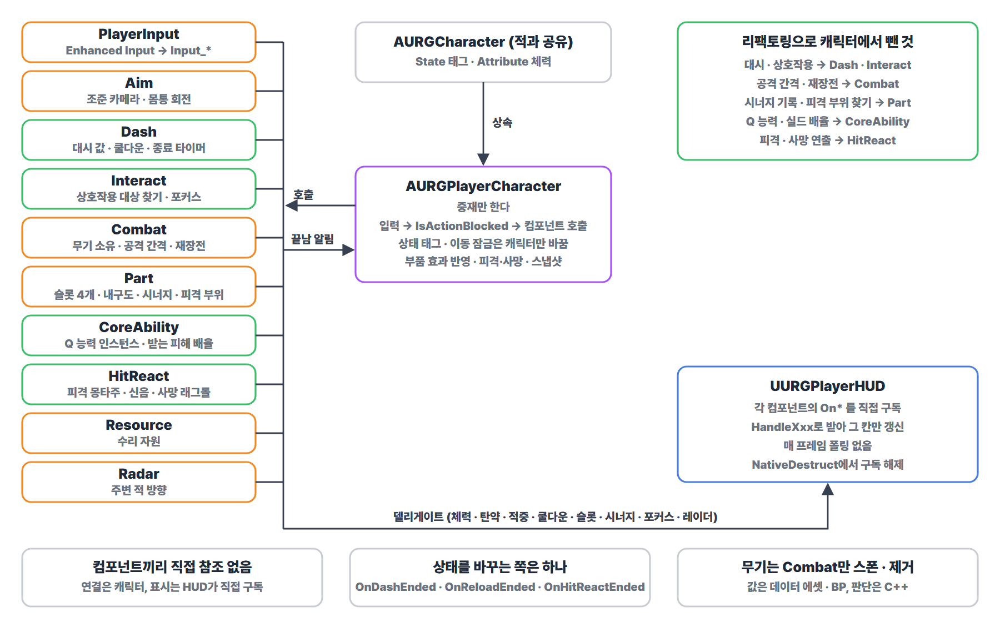

# 언리얼 로그라이크 (Unreal Roguelike)

부품 하나로 싸우는 방식이 바뀌는, 정비 로봇의 3인칭 슈팅 로그라이크입니다.
2026년도 2학기 언리얼 팀 프로젝트이며, 이 저장소에는 팀에서 **제가 맡은 플레이어 · 전투 쪽 코드만** 모았습니다. 발표 뒤 2026년 11월에 제가 맡은 코드를 다시 리팩토링했습니다.

- **포트폴리오**: [언리얼 로그라이크 (노션)](https://www.notion.so/3f2048b7ae3481909bb3c6f12efe70dd)
- **플레이 영상**: https://youtu.be/0J_BJj9XG8w
- **인원 · 기간**: 2명 (프로그래머 2명) · 2026.08.19 ~ 2026.10.07 · 저는 팀장 · 클라이언트 프로그래밍
- **엔진**: Unreal Engine 5.8 · C++

> 이 저장소는 **코드 열람용**입니다. 팀 저장소는 비공개이고, 적 AI · 스테이지 흐름 · 보스 · 일부 미니게임 등 팀원 코드와
> 에셋(Paragon 등)이 빠져 있어서 이 저장소만으로는 빌드되지 않습니다.

## 먼저 볼 코드

- **캐릭터 (중재자)** — 입력 → 차단 검사 → 컴포넌트 호출, 부품 효과 반영, 피격 · 사망 처리
  - `Source/Unreal_Roguelike/Characters/URGPlayerCharacter.h`
- **부품 데이터** — 슬롯 · 이름 · 아이콘 · 시너지 태그 · 내구도를 한 에셋에 담습니다
  - `Source/Unreal_Roguelike/Equipment/URGPartDataAsset.h`
- **부품 상태** — 슬롯 4개의 장착 부품 · 내구도 · 손상 단계 · 켜진 시너지를 들고, `OnSlotChanged` · `OnSynergyChanged`로 알립니다. 맞은 뼈로 부위를 찾는 표도 여기 있습니다
  - `Source/Unreal_Roguelike/Component/URGPartComponent.h`
- **코어 능력** — Q 능력 인스턴스를 들고 교체 · 발동 · 받는 피해 배율(실드)을 맡습니다. 능력 자체는 쿨다운 · 지속 시간만 처리하는 작은 `UObject` 베이스에서 파생합니다
  - `Source/Unreal_Roguelike/Component/URGCoreAbilityComponent.h` · `Source/Unreal_Roguelike/Ability/URGCoreAbility.h`
- **전투** — 무기 소유(스폰 · 제거는 여기서만), 공격 간격, 재장전, 적중 시 시너지 효과
  - `Source/Unreal_Roguelike/Component/URGCombatComponent.h` · `Source/Unreal_Roguelike/Equipment/URGWeapon.h`
- **수리** — 슬롯별 규칙 표(미니게임 클래스 + 기준 점수)로 미니게임을 열고, 점수(0~1)가 기준 이상인지만 봅니다
  - `Source/Unreal_Roguelike/Equipment/URGRepairStation.h` · `Source/Unreal_Roguelike/UI/URGMinigameUI.h`
- **HUD** — 컴포넌트 델리게이트를 구독하고 `NativeDestruct`에서 해제합니다. 히트 마커 · 데미지 숫자는 별도 위젯입니다
  - `Source/Unreal_Roguelike/UI/URGPlayerHUD.h` · `Source/Unreal_Roguelike/UI/URGHitFeedbackUI.h`

## 구조와 리팩토링 (2026.11)

### 구조

- 플레이어 캐릭터에는 컴포넌트 10개가 붙어 있습니다. 캐릭터는 **중재만** 합니다: 입력을 받아 지금 행동할 수 있는지(`IsActionBlocked`) 보고, 해당 컴포넌트를 부르고, 상태 태그와 이동 잠금을 바꿉니다.
- 컴포넌트끼리는 서로 모릅니다. 대시 · 재장전 · 피격 반응이 끝나면 컴포넌트는 `OnDashEnded` 같은 델리게이트로 **끝났다는 사실만** 알리고, 상태를 되돌리는 건 캐릭터가 합니다.
- HUD는 각 컴포넌트의 델리게이트를 직접 구독하고 바뀐 칸만 다시 그립니다. 매 프레임 값을 읽어 오지 않습니다.

### 리팩토링 전후

프로젝트 발표 뒤, 혼자서 제가 맡은 코드를 다시 정리했습니다. 목표는 **플레이어 캐릭터에 몰려 있던 로직을 컴포넌트로 나누고 캐릭터는 중재만 하게** 만드는 것이었습니다.
`URGPlayerCharacter.h/.cpp`는 1,496줄에서 978줄이 됐습니다.

| 무엇 | 전 | 후 | 왜 |
|---|---|---|---|
| 대시 · 상호작용 | 캐릭터가 대시 타이머 · 쿨다운과 상호작용 트레이스를 직접 처리 | `URGDashComponent` · `URGInteractComponent`. 끝나면 델리게이트로 알림 | 캐릭터는 상태 태그만 바꾸고, 시간 재기는 기능을 가진 쪽이 한다 |
| 공격 · 재장전 | 공격 간격 · 재장전 타이머가 캐릭터에 | `URGCombatComponent`로. 재장전을 취소해도 `OnReloadEnded`를 보냄 | 취소 경로에서 재장전 상태 태그가 남는 문제를 막는다 |
| 근접 판정 | 애님 노티파이가 매 프레임 트레이스. 판정이 잘 안 맞음 | 노티파이는 시작 · 끝만 알리고, 무기가 그 구간에만 Tick. 손 아래 세로 캡슐로 판정 | 판정은 무기의 책임. 리팩토링 전부터 있던 안 맞는 버그도 함께 고침 |
| Q 능력 | 능력 인스턴스 · 알림 델리게이트가 캐릭터에. 실드가 켜졌다는 기록이 두 군데 | `URGCoreAbilityComponent`. 받는 피해 배율은 능력에 물어봄 | 기록이 한 곳이라 실드를 끄는 경로가 되돌리기를 빠뜨릴 수 없다 |
| 시너지 · 피격 부위 | 시너지 개수는 부품 컴포넌트, 켜짐 기록 · 알림은 캐릭터. 뼈 → 슬롯 표도 캐릭터에 | 둘 다 `URGPartComponent`로. 바뀐 태그만 알림 | HUD가 한 곳만 읽는다. 켜지고 꺼지는 순간에만 알림이 와서 보너스 중복 방지 플래그가 필요 없어짐 |
| 피격 · 사망 연출 | 몽타주 · 신음 · 래그돌이 캐릭터에 | `URGHitReactComponent` | 연출과 판단(사망 · 대시 중 무시)을 나눈다 |
| HUD | 히트 마커 · 데미지 숫자가 HUD 안에. 위젯이 사라져도 구독이 남음 | `URGHitFeedbackUI`로 분리. `NativeDestruct`에서 구독 해제 | 사라진 위젯이 계속 호출되는 위험을 없앤다 |
| 수리 장치 | 자원을 먼저 깎고 미니게임 위젯을 생성 | 슬롯별 규칙 표 하나로, 비용은 위젯 생성 뒤. 입력 모드 전환은 플레이어 컨트롤러로 | 생성이 실패하면 자원만 빠지는 문제를 막는다 |
| 픽업 · 맵 이동 | 픽업 두 종류에 회전 · 둥실거림 코드가 두 벌. 맵 이동 연출이 컨트롤러에 | `URGPickupMotionComponent` · `URGStageTransitionComponent` | 한쪽만 고쳐서 동작이 달라지는 일을 막는다 |

## 출처

작성 주체별 구분입니다.

| 부분 | 출처 |
|---|---|
| `URGStateComponent` · `URGAttributeComponent` · `URGAimComponent` · `URGAnimInstance` | 참고 프로젝트의 코드를 가져와 수정 |
| `URGPlayerHUD` · `URGRepairStation` · `URGPartSlotUI` · `URGBullet` · `URGPlayerCharacter.cpp` | 팀원이 연결용으로 덧붙인 코드가 일부 섞여 있음 |
| 시너지 효과 · 부품 비교 UI · HUD 개편 · 타이틀 · 엔딩 등 (10/6 이후 추가) | AI 코딩 도구(Claude Code)를 활용해 구현 |
| 2026.11 리팩토링 | 무엇을 나눌지는 제가 정하고, 구현은 AI 코딩 도구(Claude Code)가 하고, 제가 검수 · 테스트 · 커밋 |

## 의존성 (이 저장소에 포함되지 않음)

Unreal Engine 5.8 · Paragon 에셋 (팀 저장소)
